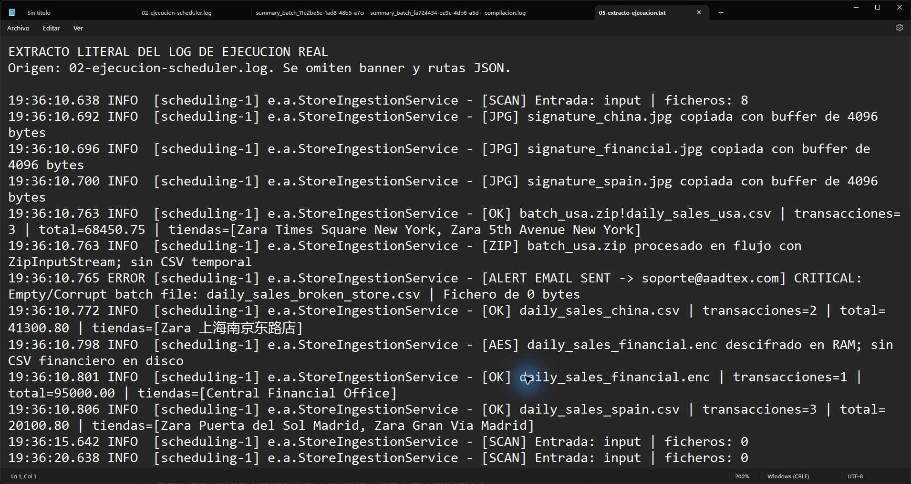
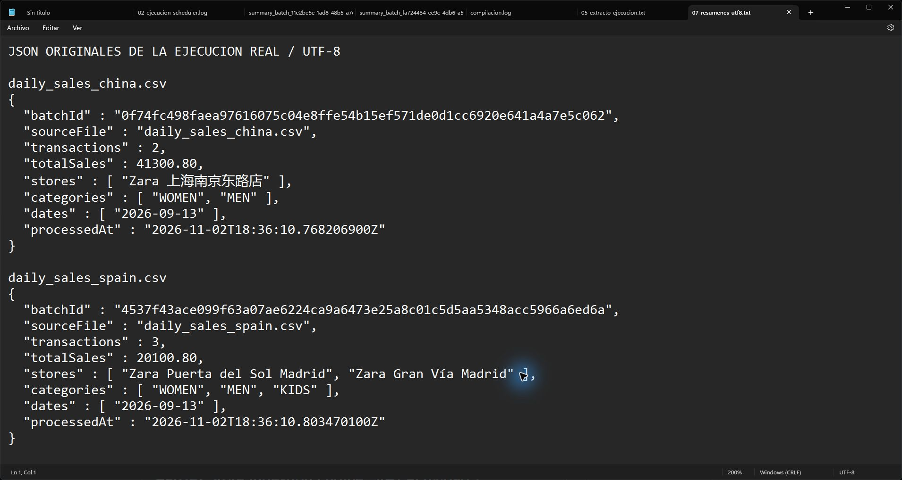
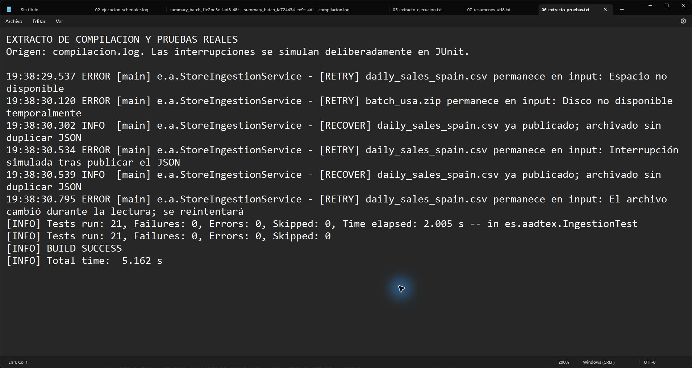

# Memoria de la actividad RA1

**Pablo Eugenio Escolar Carrellan · 2ºDAM · Acceso a Datos**  
**AadTex Store Ingestion Engine · App 1**  
Repositorio: https://github.com/lPablo27l/Acceso-a-datos  
Verificación: 2 de noviembre de 2026

## Objetivo y resultado

Automatizar la ingestión de ventas de tiendas internacionales sin intervención manual. Se implementan los ocho requisitos: tareas programadas, NIO.2, ZIP en flujo, AES-128 en RAM, lectura UTF-8, copia JPG con buffer de 4 KB, generador de pruebas y publicación JSON en un bucket local.

El resultado verificado es de cuatro lotes válidos, nueve transacciones, cuatro firmas copiadas y un archivo vacío aislado. España suma 20100.80; China 41300.80; el financiero 95000.00; USA 68450.75. El acumulado es 224852.35. El formato de entrada no especifica moneda.

## Organización del código

`AadApplication` habilita el Scheduler. `MultiLanguageDataGenerator` crea los ocho ficheros de prueba y la clave del ejercicio una sola vez. `StoreIngestionScheduler` espera a que termine el arranque y llama al motor cada cinco segundos. `StoragePaths` reúne las rutas y los movimientos NIO.2.

`StoreIngestionService` ordena la entrada, copia las firmas sueltas y procesa CSV, ENC o ZIP. `CsvSalesReader` valida cabecera, campos, importes y fechas. Usa un decodificador UTF-8 estricto y `BigDecimal`. `CryptoService` aplica AES/ECB/PKCS5Padding y la clave de 16 bytes indicada; el contenido descifrado se lee con `ByteArrayInputStream` y no se guarda en disco.

`SignatureService` combina streams con buffer y un array de 4096 bytes. Valida los marcadores de inicio y fin JPEG, con un límite de 32 MiB. `CloudBucketService` escribe el resumen en un temporal UTF-8 antes de moverlo al bucket. El CSV interno del ZIP se consume con `ZipInputStream` sin crear un CSV temporal; se revisan también pareja de nombres, rutas, truncamiento y CRC.

## Recuperación y clasificación de errores

`BatchIdentity` calcula SHA-256 del nombre del fichero, un separador y los bytes originales. Se lee con un buffer de 4096 bytes, sin cargar imágenes o ZIP completos. El identificador se usa en el nombre del JSON. El mismo nombre y contenido produce la misma identidad, y un contenido distinto produce otro lote.

Si el JSON ya está publicado, el siguiente ciclo o un reenvío termina el archivado sin volver a escribir el resumen. Esto conserva su marca temporal y evita duplicados. Si el programa se detiene después de copiar la firma del ZIP pero antes de publicar el JSON, el nuevo intento reutiliza la firma idéntica o instala la firma validada y continúa.

`BatchValidationException` representa datos inválidos y provoca la alerta simulada y el aislamiento en `error/`. Los fallos de acceso o publicación se registran como `[RETRY]` y mantienen el lote en `input/`. Antes de publicar se recalcula la huella para detectar que un productor cambió el fichero durante la lectura.

## Pruebas y ejecución real

Se ejecutaron 21 pruebas JUnit, sin fallos, errores ni pruebas omitidas. Cubren datos internacionales, totales, AES, copia JPEG byte a byte, CSV inválido, ZIP truncado/peligroso, firma pendiente, límites, reenvíos, contenido modificado y recuperación de interrupciones simuladas.

El JAR se ejecutó como proceso real de Spring Boot: el hilo programado procesó los ocho archivos iniciales y los ciclos siguientes encontraron cero entradas. Después se reinició sin cambiar los JSON y se reenvió el CSV original de España. Los nombres y hashes SHA-256 de los cuatro resúmenes permanecieron iguales. Las excepciones de disco o interrupción de las pruebas son simuladas deliberadamente; no son fallos de la demostración real.

## Evidencias originales

Las capturas son originales de Windows, con el texto ampliado en Bloc de notas. Los archivos de extractos indican su fuente; los registros íntegros y los JSON se adjuntan en `evidencias/`. No se recreó una terminal ni un IDE.

El log muestra Scheduler, buffer de 4096 bytes, ZIP, AES en RAM, los cuatro importes y el fichero de cero bytes aislado. Los dos últimos escaneos están separados por cinco segundos.

Se conservan los caracteres chinos y «Gran Vía». Ambos JSON incluyen un identificador SHA-256, la fecha original de ventas y el instante real de procesamiento.

El extracto identifica las interrupciones simuladas, los reintentos y las recuperaciones. El resultado final es `Tests run: 21, Failures: 0, Errors: 0, Skipped: 0` y `BUILD SUCCESS`.

## Uso y defensa

Descomprimir `ra1_act1.zip`, entrar en su carpeta y abrir `iniciar.cmd` con Java 21 disponible. El JAR de `dist/` incluye sus dependencias y puede arrancar sin Internet. Para otra demostración, `nueva-demo.cmd` utiliza una carpeta distinta. Para compilar: `mvnw.cmd clean verify`; para ejecutar desde fuentes: `mvnw.cmd spring-boot:run`.

En la defensa se debe explicar qué activa `@EnableScheduling`, la diferencia entre `fixedRate` y `fixedDelay`, cómo se cierran los flujos, por qué se usa UTF-8 y BigDecimal, cómo se lee un ZIP sin extraerlo y por qué una huella no es un cifrado. `DEFENSA.md` incluye respuestas y un guion de demostración.

## Decisiones y alcance

Se usa `./store_data` para que funcione al descomprimir, con ruta absoluta configurable. Las firmas se publican en `output/processed/signatures/`, conforme al requisito principal. El bucket mantiene `2026/09` como pide el ejercicio. El correo y el bucket se simulan localmente.

Los límites son 16 MiB para CSV/cifrado y 32 MiB por firma; el CSV admite una transacción por línea y campos entrecomillados. La clave fija y ECB reproducen el formato del ejercicio. Las firmas son ficticias y sólo se validan sus marcadores JPEG. La recuperación está diseñada para una sola instancia y presupone que la publicación confirmada permanece en el bucket; no garantiza transacciones distribuidas, durabilidad física ante pérdida de energía o recuperación de archivos borrados/manipulados externamente.

## Correspondencia con los requisitos

1. Scheduler: `AadApplication` y `StoreIngestionScheduler`.
2. NIO.2: `StoragePaths` y `StoreIngestionService`.
3. ZIP: `StoreIngestionService.processZip`.
4. AES en RAM: `CryptoService` y `processSales`.
5. CSV UTF-8: `CsvSalesReader`.
6. JPG y buffer 4 KB: `SignatureService`.
7. Generador: `MultiLanguageDataGenerator`.
8. JSON y bucket local: `CloudBucketService`.
