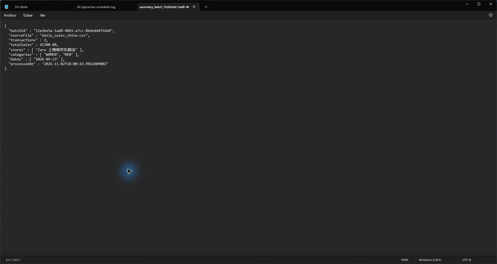
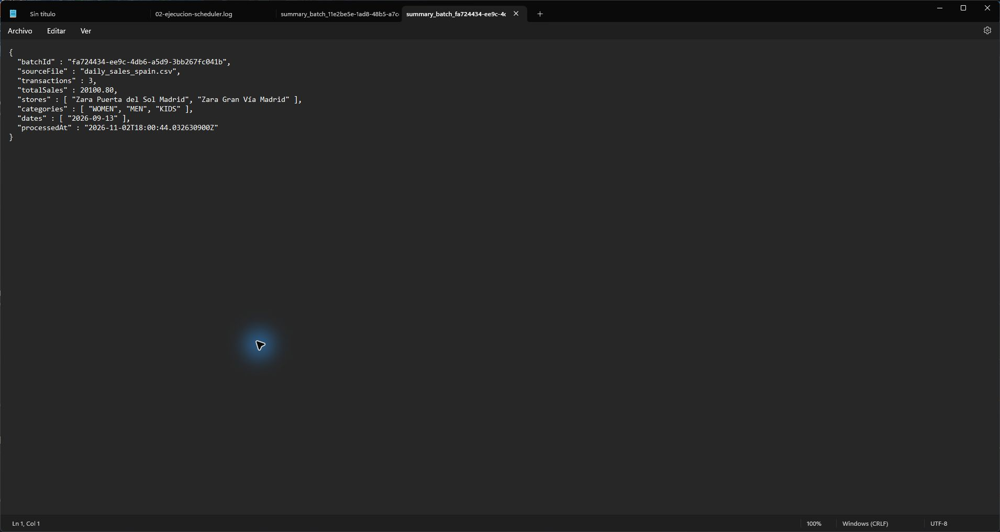
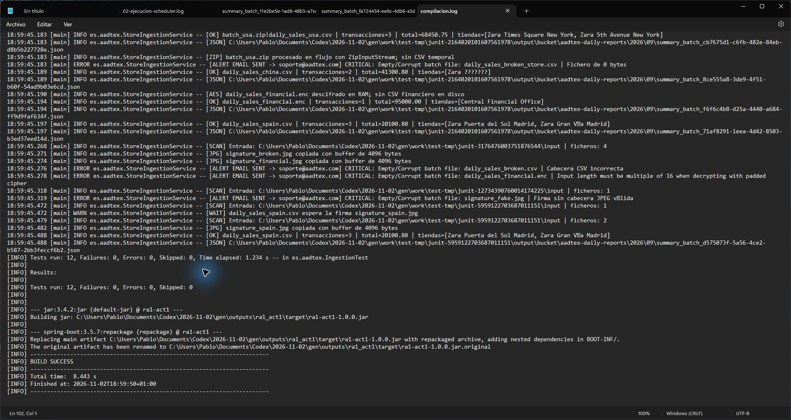

# Memoria · AadTex Store Ingestion Engine

**Alumno:** Pablo Eugenio Escolar Carrellan  
**Curso:** 2ºDAM · Acceso a Datos  
**Actividad:** RA1 Actividad 1 · Manejo de Ficheros  
**Repositorio de destino:** https://github.com/lPablo27l/Acceso-a-datos  
**Fecha de verificación:** 2 de noviembre de 2026

## 1. Objetivo

Automatizar la recepción de ventas de distintas tiendas, validar sus ficheros, calcular sus totales y dejar la salida preparada para otra aplicación. Se implementan exclusivamente la App 1 y un bucket local simulado, conforme al enunciado.

## 2. Organización y funcionamiento

`AadApplication` arranca Spring Boot y habilita las tareas programadas. `MultiLanguageDataGenerator` prepara los CSV de España y China, el balance AES, tres firmas, el lote ZIP de Estados Unidos y un fichero vacío. Las firmas son JPEG sintéticos para pruebas.

`StoreIngestionScheduler` espera a que la aplicación esté lista y llama al motor cada 5000 ms. `StoreIngestionService` crea los directorios necesarios con NIO.2 y escanea la entrada. Copia primero las firmas sueltas y procesa después las ventas. Un CSV o ENC espera si falta su firma; un fichero de cero bytes se aísla inmediatamente. Cada entrada se trata de forma independiente para que un lote corrupto no bloquee a los demás.

Los CSV se leen con `BufferedReader`, `InputStreamReader` y UTF-8 explícito. Se valida cabecera, número de campos, fechas e importes. `BigDecimal` suma las ventas sin errores de coma flotante. Las tiendas mantienen sus caracteres originales en los JSON.

El fichero `.enc` se descifra con `CryptoService` y AES-128/ECB/PKCS5Padding, usando la clave de 16 bytes `AadTexSecret2026`. El CSV descifrado se lee con `ByteArrayInputStream` y no se guarda en disco. El texto financiero de ejemplo forma parte del generador porque es un dato de prueba requerido.

El ZIP se consume entrada a entrada con `ZipInputStream` y `ZipEntry`. No se crea un CSV temporal. Se comprueba la pareja de ventas y firma y se rechazan nombres peligrosos o archivos ZIP incompletos. La firma se copia a un temporal binario antes de publicarse y los temporales se eliminan al terminar.

`SignatureService` copia imágenes con `BufferedInputStream`, `BufferedOutputStream` y un array de 4096 bytes. Verifica la cabecera y el final JPEG. `CloudBucketService` escribe cada resumen JSON en UTF-8 y lo publica mediante un movimiento del temporal al destino.

## 3. Resultados de la ejecución real

| Origen | Transacciones | Total calculado |
|---|---:|---:|
| España | 3 | 20100.80 |
| China | 2 | 41300.80 |
| Financiero | 1 | 95000.00 |
| Estados Unidos | 3 | 68450.75 |
| **Acumulado** | **9** | **224852.35** |

Se obtuvieron cuatro resúmenes, cuatro firmas copiadas y un archivo vacío en la carpeta de errores. El log conserva la alerta simulada a `soporte@aadtex.com`. No se enviaron correos reales.

Los siguientes ciclos encontraron cero entradas. Se reinició el proceso y se compararon los nombres y hashes SHA-256 de los cuatro JSON: permanecieron idénticos. Las evidencias originales se conservan en `evidencias/` y la salida completa en `evidencias/salida-real/`.

## 4. Capturas originales

Las siguientes imágenes son capturas de pantalla originales de Windows, tomadas con los ficheros reales abiertos en Bloc de notas. No se ha recreado una consola ni se ha modificado el contenido mostrado.

### Captura 1 · Ejecución automática y aislamiento

El hilo `scheduling-1` muestra la copia de los tres JPEG sueltos con buffer de 4096 bytes, la ingestión del ZIP con su cuarta firma, el descifrado en RAM, los cuatro importes y la alerta del fichero vacío. Los dos últimos escaneos, separados por cinco segundos, encuentran cero ficheros.

### Captura 2 · Ventas de China y UTF-8

El JSON contiene `Zara 上海南京东路店`, dos transacciones y un total de 41300.80. La fecha de ventas se mantiene en septiembre de 2026; `processedAt` refleja el instante real de ejecución en UTC.

### Captura 3 · Ventas de España y tildes

El JSON conserva «Zara Gran Vía Madrid» y resume las tres transacciones por 20100.80.

### Captura 4 · Compilación y pruebas

El registro muestra `Tests run: 12, Failures: 0, Errors: 0, Skipped: 0` y `BUILD SUCCESS`. Algunas alertas del registro pertenecen a pruebas que introducen deliberadamente archivos defectuosos. La consola de pruebas capturada por Maven usa la codificación de Windows y puede mostrar sustituciones de caracteres en ese registro; los JSON y el log UTF-8 de la aplicación se verifican por separado en las otras capturas.

## 5. Validación

Las 12 pruebas verifican el conjunto completo de ejemplos, los totales por lote y acumulado, la igualdad de bytes en JPEG mayores que el buffer, la conservación de español/CJK, cifrado y descifrado, el rechazo de cifrado inválido y CSV defectuosos, espera de firmas, ZIP con entradas en distinto orden, ZIP truncado, rutas peligrosas, pareja incompleta, aislamiento y repetición de ciclos/reinicio sin duplicar ejemplos.

Además se ejecutó el JAR como proceso Spring Boot real para verificar que el programador procesa la entrada automáticamente, sin llamar manualmente al servicio. El Maven Wrapper se comprobó con Maven 3.9.9 y Java 21.

## 6. Ejecución y entrega

Abrir `iniciar.cmd` desde el proyecto descomprimido. Se incluye el JAR con sus dependencias en `dist/ra1-act1.jar`, de modo que no requiere Internet para arrancar con Java 21. Abrir `nueva-demo.cmd` para repetir en una carpeta distinta sin borrar la demostración anterior. Para compilar desde fuentes, seguir el README y ejecutar `mvnw.cmd clean verify`.

La entrega es el archivo `ra1_act1.zip`. El enlace de GitHub figura en el README; la publicación efectiva debe verificarse en el repositorio antes de entregar. La guía `DEFENSA.md` permite preparar la demostración individual.

## 7. Alcance y decisiones

La ruta predeterminada es relativa (`./store_data`) para facilitar la portabilidad; la ruta absoluta del enunciado se puede seleccionar mediante una propiedad. Se mantiene el bucket `2026/09` y se elige `output/processed/signatures/` conforme al requisito principal. El README documenta estas diferencias de los documentos de partida.

El correo y el bucket son simulaciones locales. El límite de texto y cifrado es de 16 MiB por lote. La aplicación está prevista para una instancia; los ciclos y reinicios normales no duplican los ejemplos, pero no hay una transacción global ante un cierre abrupto entre la escritura del resumen y el movimiento del origen. El CSV admite campos entrecomillados, con una transacción por línea. El modo AES y la clave fija reproducen el formato solicitado para la actividad.
